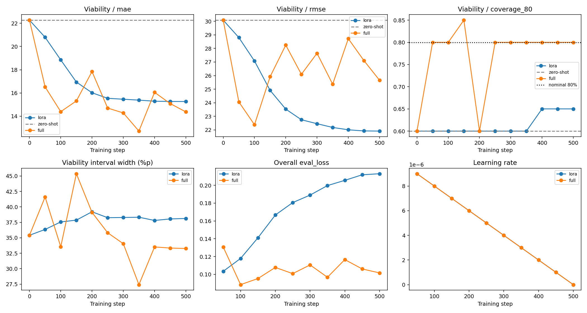
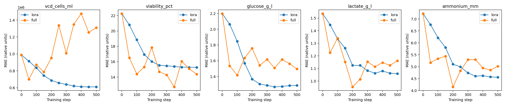
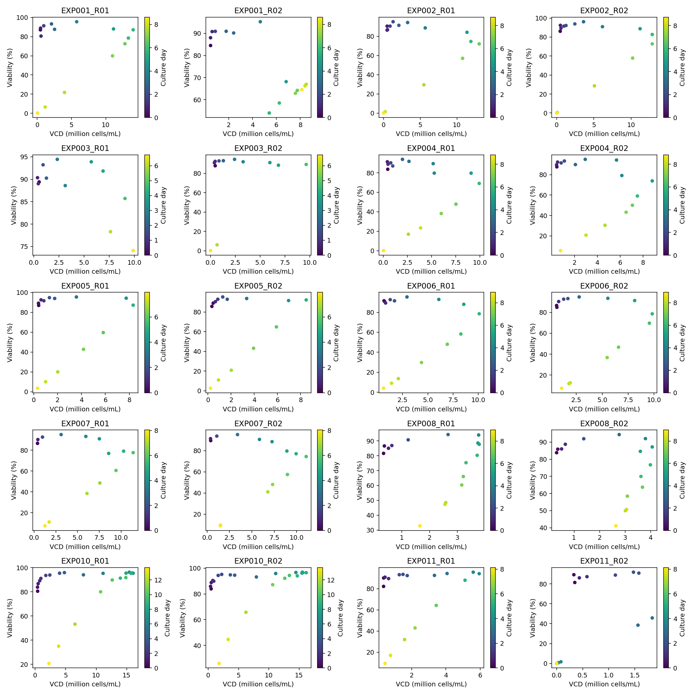

# CHO cultivation forecasting benchmark
Zero-shot vs LoRA vs Full fine-tuning on the same amazon/chronos-2 revision.
## Overall test comparison
| method | selected_step | passes_viability_guard | mean_normalized_mae | mean_coverage_80 | trainable_parameters | train_seconds | train_peak_allocated_gib | ms_per_forecast_window | final_deployment_model |
| --- | --- | --- | --- | --- | --- | --- | --- | --- | --- |
| full | 350 | True | 1.0047 | 0.4760 | 119477664 | 172.2115 | 2.2639 | 54.1123 | True |
| lora | 500 | True | 1.7519 | 0.6800 | 1206912 | 120.6398 | 1.0149 | 54.3777 | False |
| zero_shot | 0 | True | 1.1952 | 0.7600 | 0 | 0.0000 | — | 99.2297 | False |
## Fed-batch test comparison
| method | selected_step | passes_viability_guard | mean_normalized_mae | mean_coverage_80 | trainable_parameters | train_seconds | train_peak_allocated_gib | ms_per_forecast_window | final_deployment_model |
| --- | --- | --- | --- | --- | --- | --- | --- | --- | --- |
| full | 350 | True | 0.9504 | 0.5818 | 119477664 | 172.2115 | 2.2639 | 54.1123 | True |
| lora | 500 | True | 1.7178 | 0.6364 | 1206912 | 120.6398 | 1.0149 | 54.3777 | False |
| zero_shot | 0 | True | 1.3006 | 0.8091 | 0 | 0.0000 | — | 99.2297 | False |
## Fed-batch results by target
| method | target | n | mae | rmse | coverage_80 | improvement_vs_zero_shot_pct |
| --- | --- | --- | --- | --- | --- | --- |
| zero_shot | ammonium_mm | 22 | 1.4943 | 2.1377 | 0.8182 | 0.0000 |
| zero_shot | glucose_g_l | 22 | 0.8950 | 1.4537 | 0.7727 | 0.0000 |
| zero_shot | lactate_g_l | 22 | 1.4429 | 1.9837 | 0.8636 | 0.0000 |
| zero_shot | vcd_cells_ml | 22 | 1840893.6894 | 2355990.6855 | 0.8182 | 0.0000 |
| zero_shot | viability_pct | 22 | 5.2619 | 7.7910 | 0.7727 | 0.0000 |
| lora | ammonium_mm | 22 | 1.8820 | 2.2502 | 0.7273 | -25.9466 |
| lora | glucose_g_l | 22 | 1.6141 | 1.9283 | 0.4091 | -80.3445 |
| lora | lactate_g_l | 22 | 1.7128 | 2.2943 | 0.7273 | -18.7039 |
| lora | vcd_cells_ml | 22 | 1758304.9678 | 2581526.8093 | 0.5909 | 4.4863 |
| lora | viability_pct | 22 | 7.2970 | 9.6339 | 0.7273 | -38.6747 |
| full | ammonium_mm | 22 | 1.5485 | 1.7582 | 0.3636 | -3.6275 |
| full | glucose_g_l | 22 | 0.7150 | 1.0134 | 0.3636 | 20.1092 |
| full | lactate_g_l | 22 | 0.9537 | 1.2401 | 0.5455 | 33.9062 |
| full | vcd_cells_ml | 22 | 877675.4773 | 1294423.8394 | 0.7273 | 52.3234 |
| full | viability_pct | 22 | 3.5968 | 4.7217 | 0.9091 | 31.6445 |
## How to read the tables
MAE/RMSE: lower is better. VCD: cells/mL; viability: percentage points;
glucose/lactate: g/L; ammonium: mM. Coverage target is 0.80, assessed with interval width.
Normalized MAE divides each target MAE by persistence MAE before averaging targets.
Zero-shot improvement = 100*(1 - method_MAE / zero_shot_MAE); negative means worse.
Final deployment: **Full step 350**, fixed by the user after prior Validation inspection.
The full training trajectory continues to 500 steps. The exported Full weights are from step 350.
LoRA exports its Validation-selected checkpoint. Automatic suggestion is recorded separately.
Full 350 viability guard passed this run: **True**.
Training seconds include fit-time validation/checkpoints. Zero-shot training time is zero.
GPU values measure peak PyTorch allocated GiB, not device total. fit retains a source-model copy.
Inference time is warmed-up backtest wall time per window and includes DataFrame overhead.
## Protocol
Same base revision, targets, splits, context, horizon, steps, batch, seed and starting learning rate.
LoRA and Full each start from the original base. Full does not start from LoRA.
This is a same-setting single-seed comparison, not an equal-compute or tuned-optimum benchmark.
Every 50 steps: per-target MAE/RMSE, interval coverage/width, overall eval_loss and LR on fixed Validation windows.
Viability guard is reported for overall and Fed-batch Validation MAE; it does not override the user-fixed Full 350 choice. See results/deployment_selection.json and results/checkpoint_choices.json.
Paired reactors share the experiment split. Offline targets stay missing unless measured;
no future interpolation. See results/split.json and experiment_config.json.
Fed-batch Test contains only EXP012 (two reactors); avoid broad performance claims.
## Run on Colab
Upload your original Dataset.zip to MyDrive/CHO_AI/raw/Dataset.zip.
Open CHO_Colab_Drive_Training.ipynb in Colab, set GPU and ROOT, run cells in order.
The notebook generates this release directory and three model folders.
## Simulator inference
Install requirements.txt. Download a model folder from Hugging Face.
The final model is the Hugging Face **full** repository, exported from step 350.
Use cho_model.load_predict(model_dir, history_dataframe).
History must follow preprocessing.json with matching units and causal 6h grid.
## Data and license
Uhlendorff et al. (2026), https://doi.org/10.5281/zenodo.20829178 , CC-BY-4.0.
Changes: 6h right-edge last-observation binning and limited causal inline fill.
Raw data is excluded. Model and code: Apache-2.0; preserve upstream notices.
## Limits
No Keytruda clone/2000L validation. No titer or product-quality labels.
Cannot infer optimal harvest day or causal effects of arbitrary feed changes.
Single small holdout, one seed; no anomaly labels and no anomaly F1 claims.
Final claims require experiment-group cross-validation and repeated seeds.
Model uploads and GitHub uploads require explicitly enabling the corresponding cells.

## Viability Validation at each checkpoint
| method | step | n | mae | rmse | coverage_80 | mean_interval_width | eval_loss | learning_rate |
| --- | --- | --- | --- | --- | --- | --- | --- | --- |
| zero_shot | 0 | 20 | 22.2671 | 30.0863 | 0.6000 | 35.4075 | — | — |
| lora | 0 | 20 | 22.2671 | 30.0863 | 0.6000 | 35.4075 | — | — |
| lora | 50 | 20 | 20.7921 | 28.8043 | 0.6000 | 36.3500 | 0.1035 | 0.0000 |
| lora | 100 | 20 | 18.8457 | 27.0754 | 0.6000 | 37.5638 | 0.1179 | 0.0000 |
| lora | 150 | 20 | 16.9398 | 24.9096 | 0.6000 | 37.8588 | 0.1412 | 0.0000 |
| lora | 200 | 20 | 16.0183 | 23.5300 | 0.6000 | 39.2104 | 0.1667 | 0.0000 |
| lora | 250 | 20 | 15.5409 | 22.7471 | 0.6000 | 38.2531 | 0.1806 | 0.0000 |
| lora | 300 | 20 | 15.4632 | 22.4545 | 0.6000 | 38.2894 | 0.1890 | 0.0000 |
| lora | 350 | 20 | 15.3833 | 22.1793 | 0.6000 | 38.3295 | 0.1997 | 0.0000 |
| lora | 400 | 20 | 15.2924 | 22.0060 | 0.6500 | 37.8066 | 0.2056 | 0.0000 |
| lora | 450 | 20 | 15.2688 | 21.9228 | 0.6500 | 38.0528 | 0.2118 | 0.0000 |
| lora | 500 | 20 | 15.2663 | 21.9108 | 0.6500 | 38.1227 | 0.2130 | 0.0000 |
| full | 0 | 20 | 22.2671 | 30.0863 | 0.6000 | 35.4075 | — | — |
| full | 50 | 20 | 16.5211 | 24.0606 | 0.8000 | 41.6085 | 0.1308 | 0.0000 |
| full | 100 | 20 | 14.3908 | 22.3801 | 0.8000 | 33.5438 | 0.0885 | 0.0000 |
| full | 150 | 20 | 15.3144 | 25.9221 | 0.8500 | 45.3731 | 0.0954 | 0.0000 |
| full | 200 | 20 | 17.8462 | 28.2483 | 0.6000 | 39.1101 | 0.1079 | 0.0000 |
| full | 250 | 20 | 14.7005 | 26.0960 | 0.8000 | 35.8161 | 0.1009 | 0.0000 |
| full | 300 | 20 | 14.2843 | 27.6475 | 0.8000 | 34.0439 | 0.1107 | 0.0000 |
| full | 350 | 20 | 12.7200 | 25.3649 | 0.8000 | 27.4093 | 0.0968 | 0.0000 |
| full | 400 | 20 | 16.0550 | 28.7227 | 0.8000 | 33.5151 | 0.1166 | 0.0000 |
| full | 450 | 20 | 15.0879 | 27.1065 | 0.8000 | 33.3354 | 0.1061 | 0.0000 |
| full | 500 | 20 | 14.3742 | 25.6555 | 0.8000 | 33.2655 | 0.1017 | 0.0000 |

## Validation learning curves

## VCD and viability relationships
Raw observed Train/Validation pairs only. Culture/phase Pearson and Spearman, within-culture centering, change-rate correlations; descriptive only, no causal or gradient-conflict claim.

Repeated Validation tuning requires a new independent final evaluation; the previously inspected EXP012 Test is exploratory.
